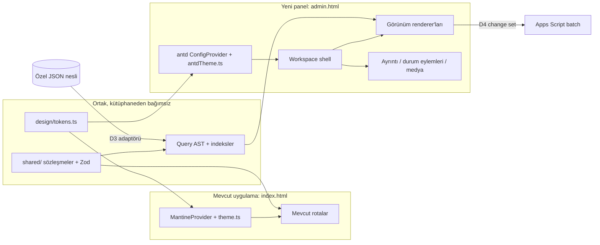

# Ant Design yönetim paneli: JSON verisinden admin paneline geçiş eylem planı

Tarih: 1 Kasım 2026. Durum: **plan; 2 Kasım 2026'da [ADMIN-PANEL-PARALLEL-PLAN.md](ADMIN-PANEL-PARALLEL-PLAN.md) ile uygulandı (aday bekliyor)**. Sonuç: antd ve Pro Components artık hiçbir profilde yüklenmiyor; hiçbir ürün bileşeni onları kullanmıyor, bağımlılık `package.json`'da duruyor. Kaldırma ya da masaüstünde bilinçli kullanma kararı kullanıcıdadır. D1–D6 ve §4 bütünlük sözleşmesi geçerlidir; §6 sıralı dilimlerinin yerini paralel plan almıştır. Bu belge kod, kurulum veya canlı değişiklik içermez; [PRE-MVP-UI.md](PRE-MVP-UI.md) içindeki ürün/veri kararlarını değiştirmez, onların üzerine arayüz kütüphanesi ve geçiş stratejisi kararını ekler.

Kullanıcının talimatı: JSON verileri istenen hale geldikten sonra, frontend bütünlüğü korunarak, Ant Design ile yönetim paneline dönüştürülecek. Önceki "Mantine korunur" kaydı bu talimatla **arayüz kütüphanesi için** değişir; veri sözleşmesi, Pages iş akışı, Git/yetki sınırları aynen kalır.

## 1. Bugün doğrulanan başlangıç noktası

| Konu | Doğrulanan durum | Kaynak |
|---|---|---|
| Uygulama | React 19.3.1, Mantine 9.7.4, TypeScript 5.9.3, Vite 8.3.5, wouter 3.13, Zod 4.6.7, ECharts 6; Node ≥ 22.12 | `package.json` |
| Tema | Tek kök `MantineProvider`; tüm değerler `src/dashboard/tokens.ts` içinde, `theme.ts` ve `cssVariablesResolver` bunu Mantine'e köprüler | `AGENTS.md`, `src/theme.ts` |
| Veri sözleşmesi | 29 koleksiyon, `{schemaVersion:1, collection, records}` zarfı, UUIDv5 kimlik, ondalık dizge para, altı `view_definitions`, 13 vocabulary, 6 workflow şablonu; gerçek veri Git dışında, özel nesil klasöründe | `data-platform/README.md`, `dictionaries/views.json` |
| Yayın | GitHub Pages statik; gerçek JSON public assets'e konmaz; kimlikli dağıtım adaptörü henüz yok | `PRE-MVP-UI.md` §5, §11 |
| Ant Design sürümleri (npm registry, 1 Kas 2026) | `antd` latest **6.6.8** (peer React ≥ 18); `latest-5` 5.29.3. `@ant-design/pro-components` latest 2.8.10 **yalnız antd 4/5**; `beta` 3.1.15-9 antd ^6. `@ant-design/x` 2.10.0 antd ^6.1.1; 1.6.x antd ^5.20. `@ant-design/icons` 6.3.4 | `npm view` çıktısı |

Doğrulanmayanlar: antd 6'nın React 19 ile projede gerçek çalışması, CSS değişkeni modu, paket boyutu etkisi, Pro Components beta kararlılığı. Bunlar S0 diliminde kanıtla kapatılır; bu tablo kurulum iddiası değildir.

## 2. Verilecek kararlar

Plan bu kararlar alınmadan uygulamaya geçmez. Öneri, gerekçe ve alternatif birlikte verilmiştir; onay kullanıcıya aittir.

| # | Karar | Öneri | Gerekçe | Alternatif |
|---|---|---|---|---|
| D1 | antd ana sürümü | **antd 6.x** | React 19 için ek yama gerekmez; Ant Design X 2.x ileride AI-first yüzeyler için bu sürümü ister; yeni panelde eski sürüme başlamak ikinci bir göç yaratır | antd 5.29 + `@ant-design/v5-patch-for-react-19` + Pro Components 2.8 stabil; X yalnız 1.x |
| D2 | Pro Components | **Kullanıcı kararı (1 Kas 2026): `@ant-design/pro-components` beta (3.x, antd ^6) kullanılır.** ProLayout kabuk, ProTable tablo modu, ProList liste modu, ProDescriptions ayrıntı, ProForm düzenleme için; altı görünüm ve sorgu AST yine proje renderer'larında kalır | Kullanıcı beta kararlılığını kabul etti; hızlı CRUD iskelesi | Beta API değişirse sarmalayıcı yüzeyi (`src/admin/ui/`) tek değişim noktasıdır; sürüm pin'lenir |
| D3 | Gerçek verinin panele ulaşması | **Pre-MVP: yerel nesil yükleme.** Kullanıcı özel nesil klasörünü tarayıcıya aktarır; veri cihazda (OPFS/IndexedDB) kalır, Pages'e hiçbir gerçek kayıt gitmez | Sunucu, kimlik ve tenant sınırı yok; bu yol hiçbir aile verisini ağa çıkarmaz ve mevcut güvenlik sınırını korur | Kimlikli HTTP adaptörü: oturum + yetkili uç nokta. Server tarafı Hüseyin Cengiz'in teknik görevi; maturity aşamasına ait |
| D4 | Panelden yazma | **Değişiklik kümesi (change set) katmanı.** Düzenlemeler nesilin üstünde sürümlü, idempotent işlem olarak tutulur; Sheets'te karşılığı olan tablolar (`app_kalemler`, `app_ayarlar`, `app_nakit`) için mevcut Apps Script batch yoluna aktarılır; karşılığı olmayan sözlük/workflow değişiklikleri "öneri" olarak dışa aktarılır | Sheets kaynak sahipliği korunur; iki yönlü otomatik eşitleme kurulmaz (PRE-MVP-UI §1) | Doğrudan Sheets yazımı yok; PostgreSQL yazımı P3 |
| D5 | Eski Mantine ekranlarının kaderi | **Dondur ve rota rota emekliye ayır (strangler).** Yeni panel ayrı giriş noktası; aynı yolculuğu kapsayan rota kabul edilince eskisi kaldırılır; son adımda Mantine bağımlılığı silinir | Tek seferde yeniden yazım pre-MVP'de doğrulanamaz; dondurma ikili bakım maliyetini sınırlar | İki kütüphaneyi süresiz birlikte yaşatma: **reddedilir** (aşağıda) |
| D6 | Koyu tema | **İlk teslimde tek açık tema** (mevcut karar); antd `darkAlgorithm` token köprüsünden geçecek şekilde hazır tutulur | Mevcut uygulama tek açık tema; iki temayı aynı anda kabul ettirmek kapsamı ikiye katlar | Koyu tema S0'da |

## 3. Mimari: ayrı giriş noktası, tek token kaynağı

- **İki giriş noktası, bir build.** `admin.html` → `src/admin/main.tsx`; Vite çoklu sayfa derlemesi aynı `dist/` içine ikisini üretir. Pages iş akışı dosyaları değişmez; yalnız derleme çıktısına bir sayfa eklenir. Yeni panelde `MantineProvider` yoktur; eski uygulamada `antd` yoktur. İki CSS sıfırlama katmanı aynı belgeye hiç girmez.
- **Tek token kaynağı.** `src/dashboard/tokens.ts` arayüz kütüphanesinden bağımsız `src/design/tokens.ts` konumuna taşınır (eski yol re-export ile korunur). `theme.ts` (Mantine) ve yeni `src/admin/theme/antdTheme.ts` aynı nesneyi okur. Renk, tipografi, boşluk, köşe, gölge, hareket ve odak için ikinci bir değer tanımı yoktur; farklı görünen iki panel bir token hatasıdır, tasarım tercihi değildir.
- **Tek veri katmanı.** `src/admin/data/` React bilmez: nesil yükleme, Zod doğrulama, kimlik/ilişki/terim indeksleri, sorgu AST değerlendirici, görünüm uygunluğu (`view_definitions`), tazelik. Eski uygulama bu katmana dokunmaz; eski GViz/Apps Script yolları olduğu gibi kalır.
- **Rota ve kimlik.** Panel wouter hash rotaları kullanır (`/aile/admin/#/alimlar` gibi); bilgi mimarisi PRE-MVP-UI §8'deki ana gezinmedir. `PageHeader` sözleşmesi (bölüm → h1 = menü etiketi → amaç → eylemler → bağlam; belge başlığı `<etiket> · aile`) antd kabuğunda aynen uygulanır; eski ve yeni ekran arasında geçen kullanıcı aynı başlık dilini görür.
- **Sınır kapıları.** ESLint `no-restricted-imports`: `src/admin/**` içinde `@mantine/*` yasak; `src/admin/ui/**` dışında doğrudan `antd` import yasak (tek sarmalayıcı yüzeyi); `src/**` (admin dışı) içinde `antd` yasak. Bu üç kural S0'da testiyle gelir.

İki kütüphaneyi uzun süre birlikte yaşatma neden reddedildi: iki tema çalışma zamanı, iki odak/hareket uygulaması, iki Select davranışı ve iki paket; bütünlük kuralı bunları aynı ekranda yan yana sunmaya izin vermez. Birlikte yaşama yalnız geçiş süresince ve ayrı belgelerde kabul edilir.

## 4. Frontend bütünlüğü sözleşmesi

Aşağıdaki her satır bir token köprüsü ya da bir kapı testidir. "Kütüphane varsayılanı" tasarım kararı sayılmaz.

### 4.1 Token köprüsü (`antdTheme.ts`)

| Proje tokenı | antd token / bileşen tokenı | Not |
|---|---|---|
| `font` (Outfit) | `fontFamily`; `fontFamilyCode` monospace | Outfit ilk sırada; WOFF2 ve Latin Extended mevcut dağıtımdan |
| 14 CSS px alt sınır | `fontSize: 16` (mevcut 1rem gövde korunur), **`fontSizeSM: 14`**, `fontSizeIcon ≥ 14`; Table/Tag/Badge/Pagination/Tooltip/Form yardımcı metni bileşen tokenlarıyla ≥ 14 | antd varsayılan `fontSizeSM` 12'dir; kapı testi hesaplanmış boyutu ölçer |
| `navy`, `blue`, `ink`, `muted`, `paper`, `canvas`, `line` | `colorPrimary`, `colorText`, `colorTextSecondary`, `colorBgContainer`, `colorBgLayout`, `colorBorder`/`colorSplit` | Lacivert hane navigasyonu, nötr zemin, beyaz veri yüzeyi (PRE-MVP-UI §8) |
| `red`, `green`, `amber` + yüzeyleri | `colorError`, `colorSuccess`, `colorWarning` ve `*Bg` | Mantine'de düzeltilen 3,3:1 hata rengi sorunu burada baştan 4,5:1 |
| `radius` 8, `timelineStepRadius` 12, `timelinePanelRadius` 16 | `borderRadius`, `borderRadiusLG`, `borderRadiusSM` | Köşe aileleri aynı |
| `duration` 240 ms, `ease` `cubic-bezier(.65,0,.35,1)` | `motionDurationFast/Mid/Slow` hepsi 240 ms; `motionEaseInOut`, `motionEaseOut`, `motionEaseIn`, `motionEaseInOutCirc`, `motionEaseOutCirc`, `motionEaseOutBack`, `motionEaseInBack`, `motionEaseInQuint`, `motionEaseOutQuint` hepsi proje eğrisi; reduced-motion'da `motion: false` | İki yönlü simetrik, pozitif süre; ARIA/durum anında güncellenir |
| `targetMin` 44 px | `controlHeight: 44`, `controlHeightSM: 44` yerine yoğunluk tokenları ayrı | Görünür boyut, etkileşim alanı, padding ayrı tokenlar |
| Odak (çevreleyen halka yasak) | `controlOutlineWidth: 0`, `lineWidthFocus: 0`, `controlOutline: transparent`; Button/Input/Select/Checkbox/Menu/Tabs/Table satırı için `:focus-visible` göstergesi **tek alt çizgi**, yalnız `html[data-keyboard]` modunda | `keyboard.ts` tek installer aynen kullanılır; Tab açar, pointer kapatır |
| Kavisli vurgu kenarı yasak | Menu `activeBarWidth: 0`, `activeBarBorderWidth: 0`; seçili öğe yüzey tonu + ağırlık; Alert/Card'da sol renkli şerit yok; Tabs ink bar düz çizgi, değdiği köşe radiussuz | Kullanıcı kararı 2026-10-19 |
| Kenarlık disiplini | `Card` varsayılanı `variant="borderless"`; ayrım boşluk/yüzey/başlıkla; kenarlık yalnız form alanı, tablo ızgarası, seçili durum | Her alanı kutuya alma yok |
| Dropdown | antd `Select`/`Cascader`/`TreeSelect` özel render; `virtual` açık/kapalı kararı ölçümle; panel yüksekliği `dropdownMaxHeight`; `getPopupContainer` sticky katmanlarıyla uyumlu | Native select yok; klavye/dokunma/okuyucu korunur |
| Katmanlar | `zIndexBase`, `zIndexPopupBase` ← `layerSticky`, `layerDropdown` | Sticky footer/filtre ve popup çakışması testli |

### 4.2 Bileşen politikası

- `src/admin/ui/` tek import yüzeyidir: `Button`, `IconButton`, `TextField`, `Select`, `Table`, `Drawer`, `Dialog`, `Tabs`, `Menu`, `Tag`, `Status`, `Disclosure`, `FormFooter`. Her sarmalayıcı antd bileşenine proje tokenlarını ve odak/hareket sözleşmesini uygular; ekran kodu antd prop'larına değil bu yüzeye bağlıdır.
- İş kuralları bileşenlerde yeniden hesaplanmaz; ölçü, durum ve ilişki anlamı veri katmanından gelir.
- Mağaza tarzı kart ızgarası varsayılan değildir; `listing` modu bile yoğun iş listesi dilindedir.
- Tutarlar `tabular-nums`, hizalı; kaynak açıklaması alanın yakınında düz satır.
- Fotoğraf yalnız seçili kayıt için istenir; galeri preload veya precache yok.

### 4.3 Kapı testleri (S0'da kurulur, her dilimde çalışır)

| Kapı | Araç | FAIL koşulu |
|---|---|---|
| Çevreleyen odak halkası | Playwright, Chromium + WebKit, klavye modu | Herhangi bir odaklı öğede `outline-width > 0` veya çevreleyen `box-shadow`; klavye odağı görünmez |
| Minimum metin | Playwright hesaplanmış stil taraması, 320/360/375/390/tablet/1440 | Herhangi bir görünür metin `< 14px` |
| Hareket | Playwright, geçiş sırasında kare örneği | Easing proje eğrisi değil; süre 0 veya tek yönlü; reduced-motion'da animasyon sürüyor |
| Vurgu kenarı | DOM taraması | Radiuslu öğede tek kenar `border-*-color` farklı ve renkli |
| Yatay taşma | 320'de `scrollWidth > clientWidth` belge düzeyinde | Taşma yalnız tablo kapsayıcısında olabilir |
| Tipografi | Font yüklenmiş, `İ ı Ğ Ş` ve `I/l/1` ayrımı 14 px tabloda | Fallback kırpması veya kelime ortası bölünme |
| Kütüphane sınırı | ESLint + vitest import testi | Admin'de Mantine, eski kodda antd, `ui/` dışında ham antd |
| Gerçek veri sızıntısı | Build sonrası `dist/` taraması | Nesil manifesti, UUID deseni veya özel klasör yolu `dist/` içinde |

## 5. "JSON hazır" kapısı: UI işi ne zaman başlar

Kullanıcı verinin "istediği gibi" geliştirilmesini önkoşul koydu. Bu kapı aşağıdaki maddeler kanıtla kapanınca açılır; biri açıksa S1'den ileri gidilmez, S0 (iskelet) yine yapılabilir.

1. `schemaVersion` ve koleksiyon allowlist'i dondurulmuş; `validate.mjs` kapısı yeşil; değişiklik ancak sürüm artışıyla.
2. `view_definitions`, `vocabularies`/`terms`, `workflows` son hali; kategori omurgası (PRE-MVP-UI §6) kullanıcı onaylı.
3. Kaynak sahipliği matrisi: her koleksiyon için tek yetkili tablo/alan; 2 unmapped tablo ve 22 türetilmiş tablo kararı yazılı.
4. 469 formül hatası kaynak/etkilenen tüketici ile sınıflanmış; panelde nasıl gösterileceği (`issues`) kararlı.
5. Pivot için leaf-row sahiplik haritası var ya da pivot ilk teslim dışında bırakıldığı yazılı.
6. Medya referansları: doğrulanmış/aday/eksik üç durumu ayrılmış; lisans alanı dolu veya "bilinmiyor".
7. D3 ve D4 kararları alınmış; nesil yükleme biçimi (klasör/zip) ve change set dışa aktarma hedefi belli.
8. Sentetik test nesli: gerçek değer içermeyen, şema ile birebir aynı, `fixtures/generation-synthetic/` altında Git'te; tüm UI testleri yalnız bunu kullanır.

Not (P0c): Sentetik nesil `node scripts/synthetic-generation.mjs` ile deterministik üretilir ve `fixtures/generation-synthetic/<sha256>/` altında Git'tedir; `data-platform/cli.mjs validate` kapısından geçer. Gerçek nesil yalnız dev sunucusunda, `AILE_GENERATION_DIR` ortam değişkeniyle `/__aile/generation/*` yolundan salt okunur servis edilir (`src/admin/devServer/privateData.ts`, `apply: 'serve'`); build çıktısına girmez.

## 6. Dilimler

> 2 Kasım 2026: Bu sıralı dilimler kapsam listesi olarak korunur. Yürütme sırası, worktree/dal düzeni, 320 px öncelik (D7), uyarlamalı teslim (D8) ve yalnız Chromium + WebKit kuralı (D9) için [ADMIN-PANEL-PARALLEL-PLAN.md](ADMIN-PANEL-PARALLEL-PLAN.md) geçerlidir.

Her dilim tek başına incelenebilir ve geri alınabilir; önce başarısız test, sonra en küçük düzeltme, aynı testte yeşil; ardından bağımsız `standards-reviewer` incelemesi (salt okunur). 320 kabulü diğer genişliklerden önce gelir. Firefox çalıştırılmaz. Chromium/WebKit sonucu gerçek Chrome/Safari sayılmaz; gerçek cihaz ayrı rapor edilir.

### S0 — Karar kaydı ve iskelet (JSON kapısından bağımsız)

- Amaç: D1–D6 kararlarını `docs/` içine ADR olarak işlemek; antd kurulumu; `admin.html` giriş noktası; token köprüsü; kabuk (Layout + Menu + `PageHeader` eşleniği + boş Work Canvas); §4.3 kapılarının hepsi.
- RED önce: kütüphane sınırı testi (admin'de Mantine import eden sahte dosya FAIL), odak halkası testi (antd varsayılan Button FAIL), `fontSizeSM` testi (varsayılan 12 FAIL), vurgu kenarı testi (Menu varsayılan FAIL), 320 taşma testi.
- Uygulama: `antd`, `@ant-design/icons`, `@ant-design/pro-components@beta` eklenir (pin'li; beta kararı D2); `vite.config.ts` çoklu giriş; `src/design/tokens.ts` taşıma + re-export; `antdTheme.ts`; `src/admin/ui/` ilk sarmalayıcılar; ESLint kuralları.
- Kabul: `pnpm typecheck`, `pnpm test`, `pnpm build` yeşil; eski uygulamanın E2E paketi değişmeden yeşil; `dist/admin.html` üretildi; paket boyutu önce/sonra kaydedildi (admin chunk'ları eski giriş noktasına girmiyor, service worker precache listesi admin'i içermiyor); 320 ve 1440 ekran görüntüleri kanıt.
- Dışında: hiçbir gerçek veri, hiçbir iş ekranı.

### S1 — Veri katmanı (React'siz)

- Amaç: nesil yükleme (D3 adaptörü), manifest/hash doğrulaması, Zod şemaları (`partition.schema.json` ile uyumlu), kimlik/ilişki/terim ağacı indeksleri, sorgu AST (aynı boyutta OR, boyutlar arası AND, ebeveyn alt terimleri kapsar, join filtresi), `view_definitions` uygunluk kontrolü, tazelik/stale/error durumları.
- RED önce: bozuk hash reddi; yarım nesil reddi (son iyi nesil korunur); yetim ilişki raporu; ebeveyn seçiminin alt terimleri kapsaması; aynı sorgunun altı modda aynı ID kümesi; "Bebek" bağlamı ile proje aşamasının bağımsız filtrelenmesi; `kind` için desteklenmeyen modun gerekçeli reddi.
- Kabul: Vitest; sentetik nesil ile 10 bin kayıt sentetik yük testi (gerçek kapasite iddiası değil); parse/indeks süresi ve bellek ölçümü kaydı; gerçek nesil yalnız yerel elle doğrulama (`not_run` CI).

### S2 — İlk dikey dilim: Alımlar ve eşyalar

- Amaç: `purchase_needs` için `listing` + `table`, açık sol filtre paneli (kategori ağacı, oda, proje aşaması, yaşam bağlamı, tedarik/ödeme durumu, fiyat/fotoğraf eksikliği), sorgu çubuğu, ortak ayrıntı yüzeyi (kimlik/fotoğraf → plan/gerçek → durum ve eylem → bağlı kayıtlar → kaynak/audit), medya galerisi (yalnız seçili görsel, eksik açık).
- Yolculuklar: "ne alacağım?", "koltuk ne kadar / ne zaman / hangi araçla?", "taşınma sonrası mutfakta ne eksik?", "yanlış işaretledim, geri al" (S4'e kadar yalnız durum düzeltme, geçiş motoru yok).
- RED önce: 320'de ana eylem/filtre/odak kaybolmuyor; görünüm değişiminde seçim, filtre, sıralama, odak korunuyor; tablo yalnız kendi kapsayıcısında kayıyor, `DocType` benzeri kelime bölünmüyor; Escape/Vazgeç/Kaydet sonrası odak açan kayda dönüyor; yanlış ürün fotoğrafı gösterilmiyor (aday ≠ doğrulanmış).
- Kabul: 320→1440 sırası, klavye ve dokunma, Chromium + WebKit; bağımsız UI QA; önce/sonra ekran görüntüleri; ağ kanıtı (yalnız manifest + ilgili parçalar + seçili görsel).

### S3 — Ödemeler ve bütçe gözlemleri

- Amaç: `payments` için `listing`/`table`/`timeline`; `budget_observations` + `forecast_months` için dönem tablosu; plan/gerçek/forecast `record_basis` ayrımı görünür; forecast bakiyeleri toplanmaz.
- RED önce: alım tutarı + taksit ödemesi iki kez toplanmıyor; farklı para birimi toplanmıyor; forecast olayı gerçek ödeme gibi görünmüyor; mevcut Mantine Pano/Finansman ile aynı kaynaktan aynı tutar (parity testi).
- Kabul: parasal uzlaşım testleri; eski ekranla sayı eşitliği kanıtı.

### S4 — Workflow runtime, Kanban, görevler, Undo

- Amaç: sürümlü state runtime (`workflow_definitions` → geçiş, guard kimlikleri, zorunlu alanlar), `workflow_events` üretimi change set'e, Kanban aynı runtime'a bağlı (sürükleme şart değil, klavyeli "Durumu değiştir"), task template'ten kullanıcı onaylı gerçek görev, telafi olayı olarak Undo.
- RED önce: yasak geçiş reddi; kanıtsız "ödendi" reddi; stale Undo başkasının sonraki değişikliğini ezmiyor; teslim işareti ödeme üretmiyor; tahmini tarih/usta uydurulmuyor.
- Kabul: runtime Vitest; Kanban E2E 320 + klavye; D4 dışa aktarımı Apps Script batch'e sentetik uçtan uca (gerçek Sheet'e yazma yalnız kullanıcı onayı ve sahip yetkisiyle).

### S5 — Gantt ve pivot

- Amaç: `work_order`/`milestone` için yalnız açık `planned_on`/`end_on` olanlarla Gantt, tarihsizler ayrı kuyruk; pivot yalnız sahipliği belirlenmiş ölçülerle, hücre kaynak kayıtları açar.
- RED önce: tarihsiz kayıt kaybolmuyor ve tahmin edilmiyor; subtotal çocuklarıyla toplanmıyor; join çoğalması çift sayım yapmıyor; Gantt/pivot kodu listing ilk açılışında indirilmiyor (ağ kanıtı).

### S6 — Yönetim CRUD ve veri kalitesi

- Amaç: sözlükler/terimler (pasifleştirme, denetimli birleştirme, alias), workflow tanımları, görünüm tanımları, `issues` kuyruğu (469 formül hatası dahil, kaynak/etki/çözüm/durum), içe aktarma geçmişi ve nesil seçimi.
- RED önce: kullanımdaki terim silinemiyor; döngü reddi; kategori taşınınca kayıtlı görünüm bozulmuyor; issue "çözüldü" kaynak kanıtı olmadan kapanmıyor.
- D4 sınırı: bu değişiklikler Sheets'te karşılığı olmadığı için "öneri" dışa aktarımıdır; repo sözlüklerinin güncellenmesi ayrı incelemeli commit'tir.

### S7 — Eski rotaların emekliye ayrılması

Rota başına kesim ölçütü: aynı yolculuk yeni panelde kabul edilmiş, parity testi yeşil, kullanıcı onayı alınmış. Sıra: `#/satinalma` → `#/butce` → `#/tadilat*` → `#/aydinlatma`, `#/yerlesim` → `#/pano`, `#/finansman`, `#/timeline` → `#/arac` → `#/ayarlar`. Her kesimde eski rota yeni panele yönlendirilir; Apps Script çevrimdışı outbox'ı kaybolmaz (D4 katmanına taşınır). Son adım: `@mantine/*` bağımlılıkları kaldırılır, `index.html` admin giriş noktasına döner, `theme.ts` silinir; `tokens.ts` tek kaynak olarak kalır. Bu adım bitmeden "Ant Design'a geçildi" denmez.

## 7. Test ve QA matrisi

| Katman | Araç | Kapsam |
|---|---|---|
| Birim | Vitest + RTL | Veri katmanı, sorgu AST, runtime, sarmalayıcılar, token köprüsü |
| E2E yerel/PR | Playwright `playwright.admin.config.ts` (yeni; eski dashboard config'e dokunulmaz) | Chromium 320 ve 1440 + WebKit; klavye, dokunma, odak, 14 px, hareket, taşma, ağ |
| Üretim ağ | Mevcut production-config kalıbı | Soğuk açılışta yalnız manifest + gerekli parça; görsel/gantt/pivot chunk'ı istenmiyor; precache dışı |
| Erişilebilirlik | axe + elle klavye/okuyucu notu | axe tam WCAG 2.2 AA kanıtı değildir; kapsam dışı `not_run` yazılır |
| Bağımsız inceleme | `standards-reviewer` (salt okunur) | S0, S1, S2, S4, S6 ve her kesim adımı |
| Gerçek cihaz | Elle; iPhone Safari, Android Chrome, macOS Safari/Chrome | Emülasyondan ayrı rapor; yapılmadıysa `not_run` |

Yeni Playwright config'i mevcut CI iş akışına eklemek workflow dosyası değişikliğidir; mevcut kullanıcı kararı gereği ayrı gündem maddesidir, o zamana kadar yerel kapıdır ve raporda "CI'da yok" diye yazılır.

## 8. Performans bütçesi

Ölçüm koşulları: production build, temiz profil, soğuk açılış, sentetik nesil, Chromium 320 ve 1440.

- Eski giriş noktasının mevcut bütçeleri gerilemez (admin chunk'ları ona girmez).
- Admin ilk açılış: manifest + kabuk + aktif koleksiyonun ilk parçaları; ham arşiv ve 200 MB üzeri kaynak hiç indirilmez.
- İlk yararlı kayıt, filtre gecikmesi, parse süresi ve bellek ayrı ölçülür; LCP 2,5 sn / INP 200 ms / CLS 0,1 laboratuvar hedefleridir, saha başarısı değil.
- antd ağaç sarsma ve `cssinjs` çalışma zamanı maliyeti S0'da önce/sonra KiB (sıkıştırılmış) olarak kaydedilir; kabul edilen bütçe o ölçümle birlikte yazılır.

## 9. Görev sahipleri ve yetki sınırları

- Claude: ayrı worktree'de uygulama, test, yerel commit; main/push/Pages yetkisi yok (mevcut kullanıcı kararı).
- Codex: main, push, Pages yayını, Apps Script deploy.
- Hüseyin Cengiz: D3 kimlikli uç nokta seçilirse sunucu/servis/güvenlik kurulumu ve doğrulaması; bu planda sunucu işi yok.
- Asistan Hüseyin: yalnız özel alan adı/DNS gerekirse GoDaddy tarafı; bu planda DNS işi yok.
- Kullanıcı: D1–D6 kararları, kategori omurgası onayı, rota kesim onayları, gerçek Sheet'e yazma onayı.

Bu plan canlı Google paylaşımı, Apps Script dağıtımı, yeni servis, cron/zamanlanmış iş veya bağımlılık yükseltmesi için yetki vermez.

## 10. Riskler

| Risk | Etki | Önlem |
|---|---|---|
| antd 6 + React 19 kombinasyonunda beklenmeyen davranış | S0 gecikir | S0'da sentetik kanıt; başarısızsa D1 alternatifi kullanıcıya somut farkla sunulur |
| İki kütüphanenin geçişte görsel ayrışması | Bütünlük algısı bozulur | Tek token kaynağı, aynı `PageHeader` dili, rota rota hızlı kesim, ekran görüntülü parity |
| antd varsayılanlarının proje kurallarını delmesi (odak, 12 px, Menu şeridi) | Kural ihlali | §4.3 kapıları S0'da kurulur, her PR'da çalışır |
| Gerçek verinin yanlışlıkla `dist/`/Git'e girmesi | P0 sızıntı | Build sonrası tarama kapısı, exporter'ın mevcut reddi, yalnız sentetik fixture |
| Change set ile Sheets'in çakışması | Veri kaybı | Sürüm/önkoşul (mevcut Apps Script `precondition_failed`), çatışma UI, sessiz ezme yok |
| Pro Components beta API değişimi | Sarmalayıcı yüzeyinde kırılma | Sürüm pin'li; `src/admin/ui/` tek değişim noktası; her Pro güncellemesi ayrı incelemeli commit |
| Kapsam kayması: altı modun hepsi birden | Teslim gecikir | S2 tek dikey dilim; sonraki modlar veri uygunluğuna bağlı |

## 11. Bu belgenin doğrulama durumu

- npm registry sürüm bilgileri 1 Kasım 2026'da okundu; kurulum, derleme ve çalıştırma yapılmadı.
- Mevcut kaynak (`package.json`, `theme.ts`, `tokens.ts`, `routes.tsx`, `views.json`, `data-platform/README.md`, `PRE-MVP-UI.md`, `AGENTS.md`) okundu.
- Hiçbir UI, bağımlılık, workflow, Sheets veya Pages değişikliği yapılmadı. Tüm kabul ölçütleri `not_run`.
